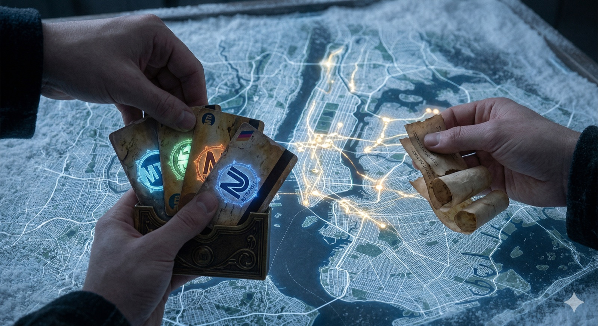
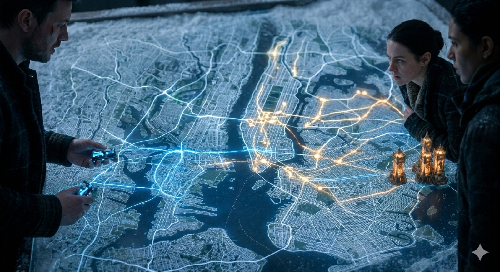
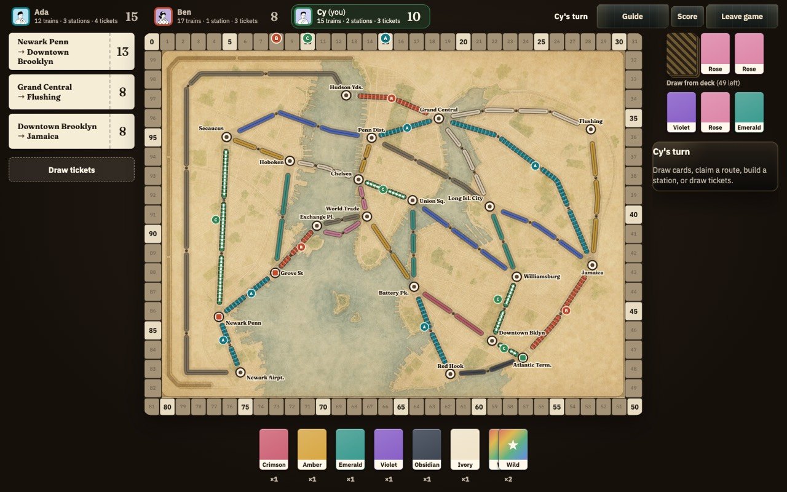
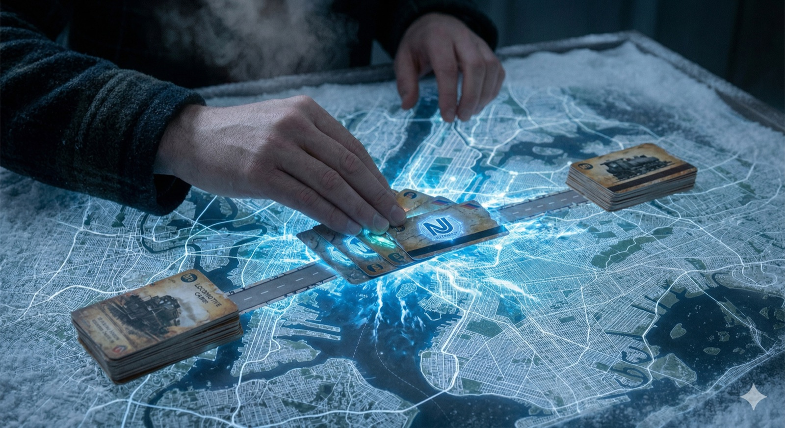

# Hudson Hustle



Hudson Hustle is a route-building board game for 2 to 4 players, set on the transit map of New York and New Jersey. Collect transit cards, claim the crossings you need before a rival does, and connect the cities on your secret tickets.

**[Play it in your browser](https://hudson-hustle.vercel.app)**. There is nothing to install and no account to make.

## The game in one minute



Everyone starts with a hand of transit cards, a set of train pieces and a few destination tickets that only they can see. A ticket names two cities. Connect them with your own routes before the game ends and you score it. Fail and you lose the same points.



The map is tight on purpose. There are only so many ways across the Hudson and the East River, and a route someone else has claimed is gone. Most of the game is deciding which crossing you cannot afford to lose, and taking it one turn before somebody else does.

## Your turn



Do exactly one of these four things.

**Draw transit cards.** Take two, from the five face-up cards or blind from the deck. A face-up locomotive is wild and counts as your whole draw.

**Claim a route.** Pay cards that match the route's colour and length, and place your trains on it. Gray routes take any single colour. Longer routes score far more than short ones.

**Draw tickets.** Take new destination tickets and keep at least one. More tickets mean more points, and more ways to lose them.

**Build a station.** Put a station in a city to borrow one neighbouring route that a rival owns, for ticket scoring only. You have three, and each one you leave unbuilt is worth points at the end.

## Three kinds of route

- **Ordinary routes** cost what is printed on them.
- **Tunnels** are a gamble. When you claim one, extra cards are turned over, and each card that matches your colour raises the price by one. If you cannot pay the difference, the claim fails and the turn is gone.
- **Ferries** need locomotives as part of the payment. The route shows how many.

## How it ends

When a player is down to two trains or fewer, everyone else gets one last turn. Then the scores are added up:

- points for every route you claimed
- plus each ticket you completed, minus each ticket you did not
- plus a bonus for every station you never built
- plus a bonus for the longest continuous line on the board

The highest score wins.

## Ways to play

- **Around one laptop.** Pass and play with 2 to 4 people. The screen hides each hand before the next player takes over.
- **Online.** Create a room, send the invite link, and everyone plays from their own screen.
- **Against bots.** Fill any seat with an easy, standard or hard bot, on one laptop or online.

There are two maps: the New York and New Jersey map the game is named for, and a Berlin map.

After a game you can replay it move by move. If you are new, the game explains each rule the first time it comes up, and the full rulebook is one click away under **Guide**.

## A few things worth knowing before your first game

- Do not keep every ticket you are dealt. Two that share a corridor beat four that pull you in different directions.
- Take the scarce crossing early. Cards come back; a claimed tunnel under the Hudson does not.
- Never enter a tunnel with the exact price in hand unless you are ready to lose the turn.
- A station is worth building when it rescues a big ticket, and rarely otherwise.

The complete rules are in the [player guide](docs/gameplay/player-guide.md).


Hudson Hustle is an original game. It belongs to the family of route-building board games, and its map, name, artwork and text are its own.

## Running it yourself

You need Node 20 or newer and `pnpm`.

```bash
pnpm install
pnpm dev:server
pnpm dev:web
```

The game opens at `http://127.0.0.1:5173`. Local play works without the server; online rooms need it.

Everything about the code, the deployment and how to contribute lives in the [docs index](docs/README.md) and in [AGENTS.md](AGENTS.md). Work happens on short branches that are merged into `main` by pull request, and a merge to `main` is a release.
