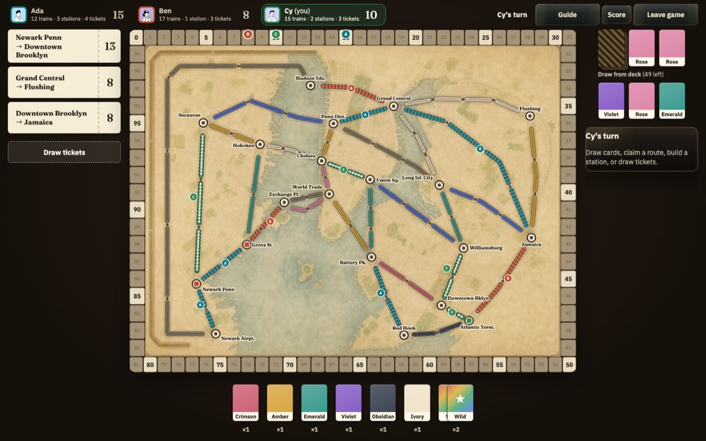
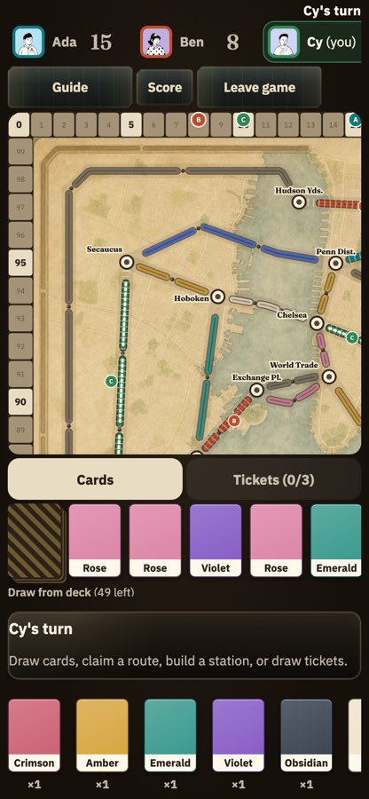
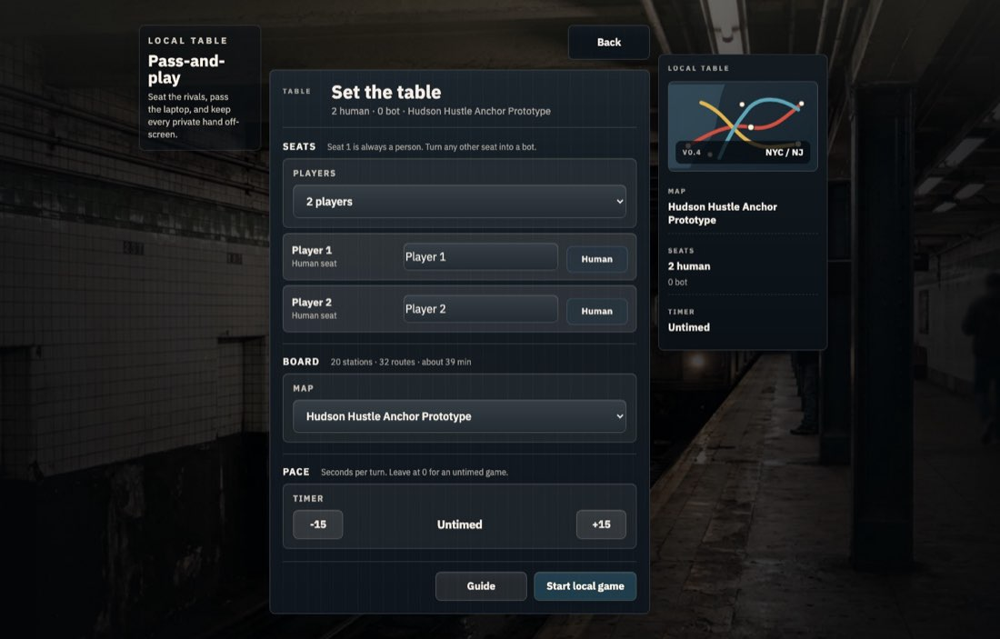
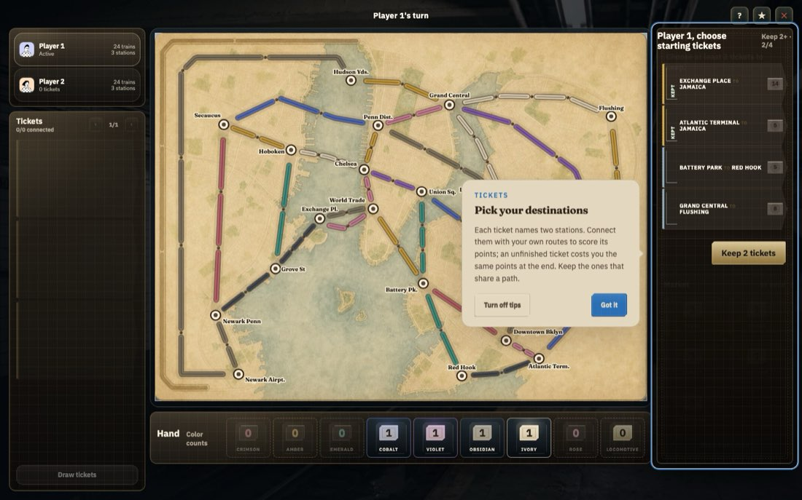
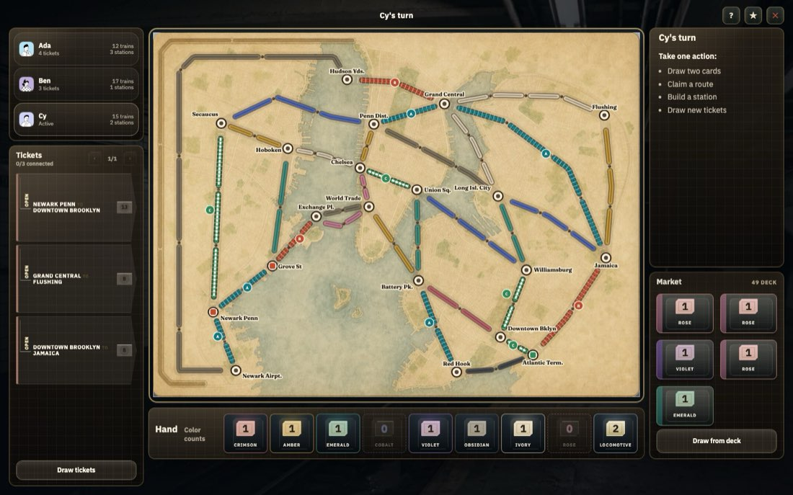
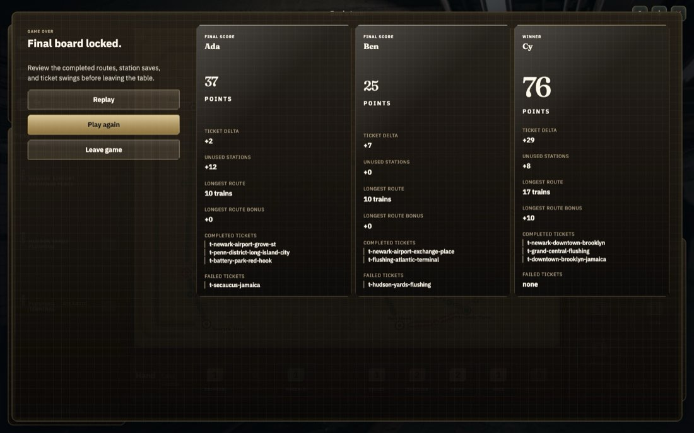
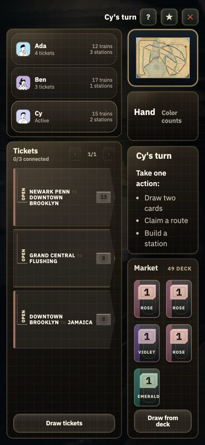
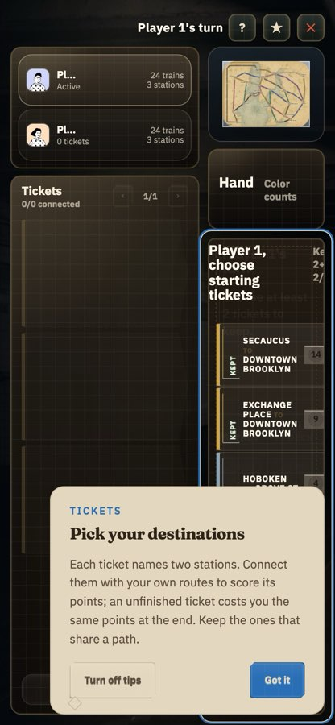

# 产品设计检查（2026-11-22）

检查对象：`main` 上刚上线的版本，桌面 1440×900 和手机 390×844，共 35 张截图，覆盖首页、开局设置、选票、对局、占线面板、计分说明、交接屏、结算、复盘、联机大厅、规则书。

方法：先用 `emil-design-foundations` 定标准（层级、间距、文案、状态），再用 `emil-ui-review` 出问题清单，按伤害程度排序。这两个技能管的是界面；"更像桌游"的方向性建议超出它们的范围，单独放在第 4 节，是我的判断，不是技能的结论。

没有覆盖到的：真实触屏手感、hover 状态、建站面板（脚本没点开）、聊天、隧道翻牌、计时器倒数、通知浮层。动效只看了静态截图和样式表，没有逐帧看；键盘操作和读屏没有测。

## 1. 结论

**需要改了再谈"像桌游"。** 地图本身是全场最好的东西：纸质感、配色、地名字体都对。问题在于地图之外的一切都在和它抢，而且抢的方式是"仪表盘"：深色玻璃面板、网格底纹、全大写小字、数字计数器。玩家看到的是一张漂亮的地图被六块控制面板围住，手里拿的不是牌，是九个计数器。

三件事阻塞：

1. 手机上不能玩。地图缩成 100 像素的缩略图，手牌区是空的。
2. 对局中看不到分数，也看不出谁是什么颜色。
3. 结算页直接显示内部 ID（`t-newark-airport-grove-st`），而且各项加不出总分。

## 2. 阻塞问题

| # | 现状 | 改成 | 为什么 |
|---|---|---|---|
| B1 | 手机对局：地图是右上角一张约 100×80 的缩略图，"Hand / Color counts" 面板里没有任何牌，行动列表被截掉最后一项。布局是两列面板并排（`styles/game/board-stage.css` 和 `styles/layout/app-shell.css` 的 820px、1040px 断点）。 | 手机上地图占满宽度并可双指缩放拖动；手牌固定在屏幕底部一行；车票、对手、牌库收进底部抽屉，一次只开一个。短期如果不做，就在窄屏上明说"请用平板或电脑"，不要给一个看起来能玩其实不能玩的界面。 | 这是功能缺失，不是打磨问题。邀请链接最常见的打开方式就是手机。 |
| B2 | 手机选票：选票面板超出屏幕右边缘（标题"Keep 2+"被切成"Ke 2+ 2/"），提示气泡又盖住第三张票，玩家名被截成"Pl..."。 | 选票改成全屏一步：四张票竖排，每张整行可点，底部固定"保留 N 张"按钮。提示气泡在这一步不要悬浮，直接写在标题下面。 | 开局第一步就读不全，新玩家会直接关掉。 |
| B3 | 对局中没有任何地方显示分数。玩家名牌（`PlayerRosterPanel`）只有车厢数、站数、票数。头像是同一套人物画，看不出谁对应地图上的哪种颜色；地图上靠 A/B/C 字母小圆点区分。 | 名牌左侧放一块玩家色（和地图上的车厢同色），右侧放大号分数。字母圆点可以删掉。 | 分数是这个游戏每回合的反馈，颜色是读图的钥匙。两样都缺，玩家只能靠记。 |
| B4 | 结算页（`GameOverPanel` / `EndgameBreakdown`）：完成和失败的车票显示成 `t-newark-airport-grove-st`；没有"线路得分"一行，所以 37 分拆不出来；赢家排在最右，和输家同样大小；标题是"Final board locked."。 | 车票显示"Newark Airport → Grove St +9"，失败的用减号。每人一列算式：线路 + 车票 − 失败 + 车站 + 最长线 = 总分，数字右对齐、等宽。按名次从左到右排，赢家那一列放大。标题直接写"Cy wins"。 | 结算是一局的高潮，现在读起来像日志。算式加不出来会让人怀疑计分有 bug。 |
| B5 | 结算层半透明，下面的车票面板和手牌的残影透上来；右侧卡片边框在最右一列断掉。 | 结算层用不透明底，或者把底下的界面模糊并压暗到看不出文字。 | 文字叠文字，哪层都读不清。 |
| B6 | 联机大厅（`LobbyScreen`）座位下显示 `seat-1`、`seat-2`；状态写"Waiting for the full table."，下面却是"Seats occupied: 2/2"。 | 删掉座位 ID。状态按真实原因写："等你点准备"／"等 Ben 点准备"／"可以开始了"。 | 内部标识漏到界面；状态文案和事实矛盾。 |

## 3. 应该改

### 3.1 对局界面

| 现状 | 改成 | 为什么 |
|---|---|---|
| 右上"Take one action"面板占一整列的上半部分，内容是四条静态文字，不能点。 | 删掉这个面板。四个行动本来就各有入口（牌库、地图、抽票按钮）。"轮到谁"放进顶部一条横幅，轮到自己时用玩家色。腾出的地方给牌库和弃牌堆。 | 一块最显眼的位置放的是说明书。层级靠减法：把不能操作的东西拿掉，能操作的自然就突出了。 |
| 手牌是九个格子，每格一个大数字加一个全大写的颜色名（10px）；数量为 0 的格子也画出来，虚线框。标题旁边写着"Color counts"。 | 画成牌：同色的牌叠成一摞并错开露边，摞上角标数量；没有的颜色不画。火车头牌单独放最右。 | 现在的"手"读起来是库存表。桌游的手感第一来源就是手里那把牌。 |
| 牌库（`SupplyDock`）五张明牌排成 2 列 3 行，每张牌中间一个大大的"1"。 | 五张明牌横排一行，牌面只有颜色和图案，不写数字。牌堆画成一摞背面朝上的牌，旁边标剩余张数。 | 明牌永远是 1 张，这个"1"不传达任何信息，却是牌面上最大的元素。 |
| 车票（`TicketSlip`）每张占 130px 高，文字只有两行 10px 全大写，竖排的"OPEN"标签要歪头读，分值是灰底灰字的小方块。三张票下面还有一个空槽。 | 票面做成真票：两端站名用地图同款衬线体，中间一条线；分值大字放右端；完成后盖一个"已连通"章。高度压到 64px 左右，空槽不画。 | 分值是票上最重要的信息，现在对比度最低。 |
| 选中车票时，地图上两端车站会加一个高亮圈（代码里有 `highlightedCityIds`），但其余部分不变，静态截图里看不出来。 | 选中一张票时，除了两端亮起，其余车站和别人的线路压暗，自己已经连通的那一段描亮。 | 找站名是新手最大的负担。现在的高亮太弱，起不到"帮我在图上找到这两个地方"的作用。 |
| 点一条线路，面板弹在地图正中间，盖住这条线和周围。已被占的线路里"Claimed by Cy."出现两遍（一遍正体一遍斜体）。 | 面板贴着线路旁边出现，不盖住线路本身；或者改成底部固定条。已占线路只说一遍。 | 玩家点线路是为了看这条线，结果面板把它挡了。 |
| 顶栏三个图标按钮：`?`、`★`、`✕`。星号是计分说明，红色叉是离开对局。 | 写成字："规则"、"计分"、"离开"。离开不要用红色叉，它看起来像关闭弹窗。 | 图标含义靠猜，而且离开是破坏性操作，放在最容易误点的右上角。 |
| "Player 1's turn"在顶部居中，14px 左右，和背景几乎同色调。 | 轮到自己时全宽横幅加玩家色；轮到别人时显示"等 Ben 行动"。 | 这是全场最重要的一条状态，现在是全屏最不起眼的一行字。 |
| 交接屏：标题"Cy, take over."左对齐，正文居中；左边"Privacy shield"说明卡的文字被挤成每行两三个词。 | 标题和正文同一种对齐。左边那张说明卡删掉，它和中间卡片说的是同一件事。 | 同一张卡两种对齐；一件事讲两遍。 |

### 3.2 开局和大厅

| 现状 | 改成 | 为什么 |
|---|---|---|
| 首页：照片压得很暗，两个入口缩在左下角，中间三分之二是空的。两个入口的小标题一个是玩法（"Pass-and-play"），一个是动作（"Start game"），不对称。 | 入口放到视觉中心，或者干脆把地图作为首页主视觉。小标题统一成玩法："一台电脑轮流玩"／"各用各的屏幕"。 | 主操作不在视线落点上。首页也没有出现游戏本身的样子。 |
| 开局设置：三块面板顶边各不对齐；右侧摘要和中间副标题重复同样的信息。 | 一块面板。摘要并进"开始"按钮上方一行。 | 三个容器讲一件事。 |
| 地图名显示"Hudson Hustle Anchor Prototype"，缩略图上印着"v0.4"。 | 玩家看到的名字写"New York & New Jersey"；版本号不上界面。 | 内部命名漏到界面。 |
| 座位行：左边"Player 1 / Human seat"，中间输入框里又是"Player 1"，右边一个写着"Human"的按钮，看不出能点。 | 输入框用占位名，左边标签删掉。人／机器人做成两段切换开关。 | 同一个名字出现两次；切换控件长得像标签。 |
| 计时器是"−15 / Untimed / +15"步进器。 | 四个预设：不限时、30 秒、60 秒、90 秒。 | 没人想要 45 秒和 75 秒的区别，步进器要点好几下。 |
| 大厅里"Copy invite link"在右侧摘要卡最下面；"Mark ready"和"Start game"并排同样大。 | 邀请链接和房间码放最上面最大。按钮只留一个主操作，随状态变："准备"→"开始"。 | 大厅里的第一件事就是把人叫进来。两个同级按钮等于没有主操作。 |
| 规则书是 9 页纯文字卡片，翻页按钮只有箭头。 | 每页配一张地图局部的图示（一条隧道、一条渡轮、一个车站）。四个行动合成一页。 | 规则靠图比靠字快。 |

### 3.3 贯穿全局

| 现状 | 改成 | 为什么 |
|---|---|---|
| 全大写小字到处都是：10px 的 `--type-2xs` 用在手牌标签、车票、徽章；8px 的 `--type-3xs` 和 6px 的 `--type-map` 用在地图上。 | 界面文字不低于 12px；全大写只留给两三处真正的标签。地图上的字不低于 9px。 | 10px 全大写在深色底上，离屏幕远一点就读不了。 |
| 每个面板都有：深色渐变、细边框、网格底纹、内阴影、外阴影。 | 面板只留一种表面处理。网格底纹删掉。 | 装饰叠了五层，哪一层都不再有意义，反而把地图衬得像另一个产品里的东西。 |
| 复盘页地图左右各留一大条深色空白。 | 复盘时地图占满可用高度，控制条叠在地图下沿。 | 复盘唯一的内容就是地图。 |

## 4. 往桌游方向改：不止修补

以下是方向性的改动，会改变界面的样子，不只是在现有布局上调整。按我认为的价值排序。

### 4.1 把屏幕当成一张桌子，而不是一块仪表盘

现在的结构是"地图 + 六块面板"。桌游的结构是"桌面上放着地图，地图周围摆着东西"。

- **地图铺满**。地图是桌布，占满除底部手牌以外的全部空间，面板浮在它上面或者干脆不存在。现在地图只占屏幕面积的四成左右。
- **底色换成桌面**。深色地铁站照片加玻璃面板是"应用"的语言。换成一种材质：木头、毛毡或者深色纸。只要一种。
- **东西有固定位置**。牌堆和明牌在地图右下角，弃牌堆在旁边，车票摞在左下角，对手的名牌沿上边排开。真实桌游里每样东西都有固定位置，玩家靠位置记，不靠标题读。
- **面板标题全部删掉**。"Hand""Market""Tickets"这些标题在桌面上不存在。一摞牌不需要写"这是牌"。

### 4.2 让棋子是棋子

- **车厢**。占线时，车厢一节一节落到线路上，每节间隔 40ms 左右，落下时有一点下沉。现在是线路换个花纹。这是整个游戏里最值得做动画的一个动作，因为它每局只发生几十次，每次都是得分。
- **牌**。抽牌时牌从牌堆飞到手里；付牌时从手里飞到弃牌堆。对手抽明牌时，所有人都能看到哪张被拿走。
- **车站**。画成一个立在城市上的小建筑，而不是给城市圆点换个颜色。
- **计分轨**。沿地图边缘画一圈 0–100 的格子，每个玩家一个棋子。占线后棋子往前走。这是这类桌游的标志性部件，也顺便解决了"对局中看不到分数"。

### 4.3 让回合有节奏

- **轮到你**：横幅用你的颜色从上方落下，停留一秒，收成顶部一条细线。
- **对手的回合**：他占的线路用他的颜色闪一下，地图自动把那条线路保持在视野里。现在对手的行动是一条文字通知，要读了再去图上找。
- **最后一轮**：现在只有一条看过一次就不再出现的提示。改成全桌一条常驻的"最后一轮"标记，每个名牌上标出还剩几回合。
- **隧道**：翻牌一张一张翻，停顿，然后揭晓加价多少。这是游戏里唯一的赌博时刻，值得三秒钟的戏。
- **结算**：不要一次把总分摊出来。先是线路分，然后一张一张翻车票（完成的加，失败的减），最后是车站和最长线。棋子在计分轨上跟着走。谁赢到最后一刻才揭晓。

### 4.4 减少"软件"的痕迹

- 文案改成桌边会说的话。"Final board locked."→"Cy wins"；"Privacy shield / Private info hidden"→"把电脑交给 Cy"；"Take one action"→删掉。
- 不显示任何版本号、ID、配置名。
- 引导提示已经改成跟随操作出现，这个方向是对的。下一步是让提示指着真实的东西（那张牌、那条线路），而不是在地图中间弹一个框。

### 4.5 手机是另一套布局，不是缩小版

竖屏：地图全屏、可缩放；手牌一行贴底；左右各一个角标（车票、对手），点开是半屏抽屉。横屏可以沿用桌面布局的简化版。这一项工作量最大，但也是唯一一个现在完全不能用的场景。

## 5. 建议的施工顺序

1. **先修不能用和读错的**：B3（分数和玩家色）、B4（结算页）、B6（大厅文案）、手牌空格子和牌库的"1"。都是小改动，一两天。
2. **再做减法**：删"Take one action"面板、删面板标题和网格底纹、统一字号下限、图标按钮改文字。界面会立刻安静下来，地图自己就突出了。
3. **然后是桌面布局**：地图铺满、东西归位、底色换材质。这一步建议先用 `emil-prototype` 做两三个方向并排比较，再定。
4. **再做棋子和节奏**：车厢落位、抽牌、计分轨、结算揭晓。用 `emil-animations` 定时长和缓动。
5. **最后是手机**：等桌面布局定了再做，否则要做两遍。

第 1、2 步不改变产品方向，可以直接做。第 3 步之后的每一项都值得先看一眼原型再投入。

## 6. 补查（2026-11-22 第二轮）

第一轮没覆盖的几项，用脚本驱动浏览器逐项查过。真机触屏没有条件测，下面的触屏结论来自 390×844 的模拟触摸。

| 项目 | 结果 | 处理 |
|---|---|---|
| 键盘：地图 | 32 条线路和 20 个车站都能 Tab 到，有读屏名称（"Secaucus to Hoboken, 2 trains, amber, open"），回车能打开面板，有键盘焦点样式。 | 没问题。但从车票到牌库要 Tab 52 次，应该改成方向键在地图内移动、Tab 只停一次。**未做。** |
| 键盘：弹窗 | 离开确认和交接弹窗没有 `role="dialog"`，打开后焦点留在背后的按钮上，Tab 连按 8 次都在弹窗外，Esc 关不掉。 | **已修**：弹窗接管焦点、Tab 困在弹窗内、Esc 取消、关闭后焦点回到原处。 |
| 键盘：占线／建站面板 | 打开后焦点留在地图上，要 Tab 过剩下的所有线路才能到面板里的按钮。 | **已修**：打开时焦点进面板，关闭时回到那条线路。 |
| 读屏 | 所有按钮和输入框都有名称。回合状态、通知、复盘说明有 `aria-live`。聊天记录没有。 | **已修**：聊天记录标成实时日志。 |
| 触屏目标 | 顶栏按钮 32px 高、车票翻页按钮 24×26，但都用伪元素把点击区扩到了 44px。手机上地图线路的点击区只有几个像素宽。 | 桌面没问题。手机地图要等手机布局重做。 |
| hover | 车票悬停会高亮两端车站，触屏点一下也会。付款预览同时响应 hover 和键盘焦点。没有只靠 hover 才能用的功能。 | 没问题。 |
| 建站面板 | 八个长得一样的"Build 某色"按钮竖排，不写要付几张牌，也不说车站有什么用。 | **未做**，放到桌游化那一轮和占线面板一起改。 |
| 聊天 | 能发能换行，输入框 16px 不会触发 iOS 缩放。没有发送按钮，只能按回车。 | 小问题，未做。 |
| 隧道翻牌 | 翻出的牌只是一行逗号分隔的文字，放在占线面板里。 | **未做**，是桌游化那一轮"回合节奏"的一部分。 |

## 7. 桌游化第一版（已做）

第 4 节的四条方向做了第一版，在分支 `claude/tabletop-layout` 上。

- **桌面**：地图在中间，外圈是 0–99 的计分轨，每人一个棋子。名牌在上、车票在左、牌堆和五张明牌在右、手牌在下，都没有面板标题。底色是一种木色，照片背景去掉了。
- **棋子**：手牌是按颜色叠起来的牌，牌面印着颜色名；明牌是牌，牌堆是一摞牌背；车票是票根，分值在撕口那一端，连通后盖章。
- **选票**：新发的票出现在左侧车票的位置，地图始终可见。原来的右侧浮层删掉了。
- **手机**：地图占大部分屏幕，手指拖动平移；牌和车票共用地图下方一个托盘，手牌固定在底部。
- **顺带修掉的**：回合小结里的内部线路 ID（"Cy claimed secaucus-midtown-west"）改成站名；占线或建站成功后面板自动关闭。

没做的：车站仍是换色圆点，没有画成立体建筑；地图内方向键移动（现在仍要 Tab 52 次）；建站面板的八个同形按钮；规则书配图；首页和开局设置页没有动。

## 8. 动效评估（`emil-animations`）

标准：动效是反馈，不是装饰。先问这个动作一局里发生多少次，再定要不要动、动多久。只动 `transform` 和 `opacity`，进场用快起慢停的曲线，退场比进场快，全部尊重"减少动态效果"。

### 8.1 这个游戏里哪些该动

| 时刻 | 一局里的频率 | 结论 | 做法 |
|---|---|---|---|
| 抽一张牌 | 每回合两次，全场上百次 | 要，但必须短 | 牌从牌堆或明牌飞到手里对应的那一摞，240ms。回答"我拿到的是哪张、放哪了"。 |
| 占一条线路 | 每人十几次 | 要，这是得分的瞬间 | 车厢一节一节落下，每节 260ms、间隔 45ms，六节的线路共约 0.5 秒。 |
| 分数变化 | 同上 | 要 | 计分轨上的棋子走到新格子，420ms。它已经在场上、只是移动，所以两头都缓。超过了 300ms 的界面上限，是有意的：这是棋子在走，不是界面在响应。 |
| 轮到你 | 每回合一次 | 要，但不能挡操作 | 顶部一个你的颜色的小横条，250ms 进、停留、180ms 出，不接收点击。最初做成横贯全屏的大横幅，评估后改小：每回合都出现的东西不能是幕布。 |
| 隧道翻牌 | 一局几次 | 可以隆重 | 三张牌每 520ms 翻一张，然后报价。任意键或点击跳过，1.8 秒后自己关。 |
| 结算 | 一局一次 | 可以隆重 | 每 320ms 报一行，按座位顺序排，总分、名次和赢家最后一起出现。点一下或按任意键直接看结果。 |
| 悬停明牌 | 高频 | 轻微 | 抬起 4px，140ms，只在真正有鼠标悬停的设备上。 |
| 付款预览 | 高频 | 轻微 | 会被花掉的牌从那一摞里抬起 12px，140ms。 |
| 键盘在地图上移动焦点 | 高频 | 不动 | 没有加任何动效。 |

### 8.2 对已有动效的修改

| 之前 | 之后 | 为什么 |
|---|---|---|
| 弹窗、占线面板、提示气泡、计分说明进场用 `ease` | 新增 `--easing-enter: cubic-bezier(0.32, 0.72, 0, 1)`，进场的东西都用它 | `ease` 起步慢。进场要立刻有反应，再柔和停下。 |
| 通知条 4.2 秒里一直在往上飘（先 12px、再 18px、最后 48px），进场占 500ms，退场占 900ms | 250ms 进场，中间完全静止，170ms 退场 | 字在动的时候不好读。退场比进场还长、还远，是反的。 |
| 提示的高亮框在目标之间移动时，动画的是 `top`、`left`、`width`、`height` | 直接跳到新位置 | 这四个属性会触发重排。它很少移动，不值得为此改成 transform。 |
| 弹窗从 `translateY(8px)` 进场 | 加 `scale(0.97)` | 只平移没有体积感；从略小的形状展开更像一个东西出现。 |
| 首页入口卡片悬停上抬，没有区分设备 | 放进 `@media (hover: hover) and (pointer: fine)` | 触屏点一下会留下卡住的悬停状态。 |

### 8.3 检测结果

用脚本驱动浏览器实际触发每个动效，读取运行中的动画参数：

- 抽牌：创建了 1 个飞行中的牌，240ms，曲线是 `cubic-bezier(0.32, 0.72, 0, 1)`，结束后从页面移除。
- 占线：两节车厢各有一个 260ms 的动画，第二节延迟 45ms；1.2 秒后标记清除；计分棋子有一个 420ms 的 transform 过渡并且位置变了。
- 隧道：三张牌的延迟是 0、520、1040ms，结论延迟 1760ms；按键能关掉。
- 轮到你：联机对局里每次回合回来都出现一次，1200ms，`pointer-events: none`。三人同屏轮流时不出现，因为交接弹窗已经说了。
- 结算：120ms 时标题和总分透明度为 0，第一行正在出现；点击后全部为 1。
- 减少动态效果：抽牌不创建飞行元素；车厢和棋子的动画时长降到 0.01ms；隧道和结算不再分步，内容一次全部显示。

没测的：真机上的帧率；Safari。隧道翻牌用了 `rotateY`，在 Safari 上的表现没有验证。

## 附：截图

- 开局设置：
- 选票和首次提示：
- 对局中：
- 结算：
- 手机对局：
- 手机选票：
